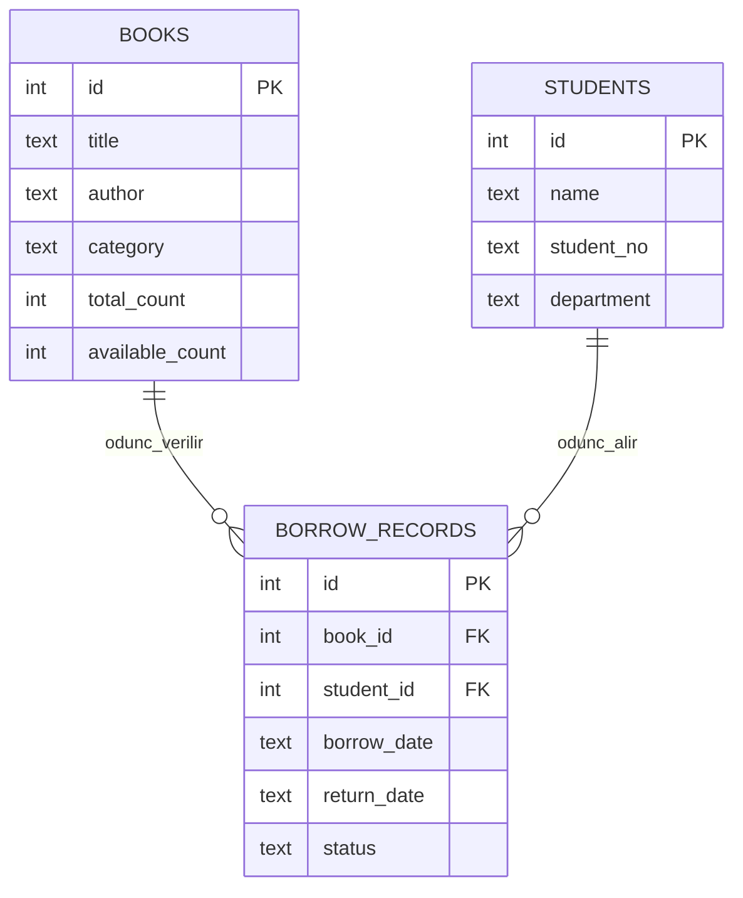

# 📚 Akıllı Kütüphane ve Öğrenci Takip Sistemi


Python ve SQLite kullanılarak geliştirilmiş, Nesne Yönelimli Programlama (OOP) tabanlı ve modüler mimariye sahip terminal kütüphane yönetim sistemidir. Sistem; kitap ve öğrenci kayıtlarını ilişkisel bir veritabanında saklar, stok ve mükerrer kayıt kontrolleriyle ödünç verme/iade süreçlerini yönetir ve SQL sorguları aracılığıyla geciken ya da en çok tercih edilen kitapları raporlar.

---

## 📑 İçindekiler

- [Öne Çıkan Özellikler](#-öne-çıkan-özellikler)
- [Proje Mimarisi ve Klasör Yapısı](#-proje-mimarisi-ve-klasör-yapısı)
- [Veritabanı Tasarımı ve ER Diyagramı](#-veritabanı-tasarımı-ve-er-diyagramı)
- [Kullanılan Teknolojiler ve Kavramlar](#-kullanılan-teknolojiler-ve-kavramlar)
- [Kurulum ve Çalıştırma](#-kurulum-ve-çalıştırma)
- [Örnek Kullanım ve Terminal Çıktıları](#-örnek-kullanım-ve-terminal-çıktıları)
- [Geliştirme Planı (Roadmap)](#-geliştirme-planı-roadmap)
- [Geliştirici ve Lisans](#-geliştirici-ve-lisans)

---

## ✨ Öne Çıkan Özellikler

### Kitap ve Öğrenci Yönetimi (CRUD)
* **Kitap Ekleme & Listeleme:** Kitap adı, yazar, kategori ve toplam adet bilgileriyle kayıt oluşturur; boş alan ve sayısal değer doğrulaması yapar. Tüm kitapları toplam ve raftaki mevcut stok (`available_count`) bilgileriyle listeler.
* **Öğrenci Ekleme & Listeleme:** Öğrenci adı, numarası ve bölüm bilgilerini kaydeder; aynı öğrenci numarasının veritabanına tekrar eklenmesini engeller.

### İş Kuralları ve Ödünç / İade Takibi
* **Stok ve Mükerrer İşlem Kontrolü:** Ödünç verme öncesinde öğrencinin ve kitabın sistemde kayıtlı olup olmadığını, raftaki kitap adedinin `0`'dan büyük olduğunu ve öğrencinin aynı kitabı hâlihazırda iade etmemiş (`borrowed`) durumda olmadığını doğrular.
* **Otomatik Stok ve Tarih Güncellemesi:** Ödünç alma sırasında raftaki stok otomatik olarak 1 azaltılır; iade işleminde kayıt durumu `returned` olarak güncellenir, `datetime` modülüyle iade tarihi işlenir ve stok 1 artırılır.

### Arama ve SQL Raporlama
* **Esnek Kitap Arama:** SQL `LIKE` operatörü ile kitap adına veya yazar adına göre kısmi eşleşmeli arama yapar.
* **Öğrenci Bazlı Kitap Listesi:** `students`, `borrow_records` ve `books` tablolarını SQL `JOIN` ile birleştirerek bir öğrencinin henüz iade etmediği kitapları listeler.
* **Geciken Kitap Tespiti:** Ödünç alma tarihinin (`borrow_date`) üzerinden 15 günden fazla süre geçmiş ve iade edilmemiş kitapları tarih karşılaştırmasıyla tespit eder.
* **En Çok Ödünç Verilen Kitaplar:** `COUNT`, `GROUP BY` ve `ORDER BY` sorgularıyla kütüphanedeki en popüler kitapları sıralar.

---

## 📂 Proje Mimarisi ve Klasör Yapısı

Kod tabanı, sorumlulukların ayrılması ilkesine uygun şekilde 5 ana modüle bölünmüştür:

```text
kutuphane-yonetim-sistemi-python-sqlite/
├── main.py          # Sürekli çalışan terminal menüsü ve kullanıcı akışı
├── database.py      # SQLite bağlantısı (library.db) ve tablo oluşturma (create_tables)
├── models.py        # Book, Student ve BorrowRecord OOP sınıfları
├── services.py      # Kitap/öğrenci ekleme-listeleme, ödünç verme ve iade servisleri
├── reports.py       # Kitap arama, öğrenci kitapları, gecikme ve popülerlik raporları
├── .gitignore       # Sanal ortam, IDE ayarları ve yerel veritabanı filtreleri
└── README.md        # Proje dokümantasyonu
```

---

## 🗄️ Veritabanı Tasarımı ve ER Diyagramı

Uygulama başlatıldığında `library.db` veritabanı dosyası ve `FOREIGN KEY` ilişkilerine sahip 3 temel tablo otomatik olarak oluşturulur:



| Tablo Adı | Sütunlar | Görevi |
| :--- | :--- | :--- |
| **`books`** | `id`, `title`, `author`, `category`, `total_count`, `available_count` | Kitap bilgilerini, toplam adedi ve raftaki müsait stok sayısını tutar. |
| **`students`** | `id`, `name`, `student_no`, `department` | Sisteme kayıtlı öğrencilerin kimlik ve bölüm bilgilerini saklar. |
| **`borrow_records`** | `id`, `book_id`, `student_id`, `borrow_date`, `return_date`, `status` | Ödünç alma/iade geçmişini (`borrowed` / `returned`) ilişkisel olarak yönetir. |

---

## 🛠️ Kullanılan Teknolojiler ve Kavramlar

* **Programlama Dili:** Python 3 (harici paket bağımlılığı olmadan standart `sqlite3` ve `datetime` modülleri)
* **Veritabanı & SQL:** SQLite — `CREATE TABLE`, `FOREIGN KEY`, `INSERT`, `SELECT`, `UPDATE`, `LIKE`, `JOIN`, `COUNT`, `GROUP BY`, `ORDER BY`
* **OOP & Veri Yapıları:** Sınıflar (`Book`, `Student`, `BorrowRecord`), modüler dosya mimarisi, `list`, `dict`, `set` ve `tuple` yapıları
* **Geliştirme Ortamı:** PyCharm

---

## 🚀 Kurulum ve Çalıştırma

Projeyi yerel ortamınızda çalıştırmak için bilgisayarınızda **Python 3** yüklü olması yeterlidir.

1. **Depoyu klonlayın:**
   ```bash
   git clone [https://github.com/KULLANICI_ADIN/kutuphane-yonetim-sistemi-python-sqlite.git](https://github.com/esmanuryavuz908/kutuphane-yonetim-sistemi-python-sqlite.git)
   ```

2. **Proje dizinine geçin:**
   ```bash
   cd kutuphane-yonetim-sistemi-python-sqlite
   ```

3. **Uygulamayı başlatın:**
   ```bash
   python main.py
   ```
   > İlk çalıştırmada `library.db` dosyası ve gerekli veritabanı tabloları otomatik olarak oluşturulur.

---

## 💻 Örnek Kullanım ve Terminal Çıktıları

### Ana Menü
```text
====== KÜTÜPHANE YÖNETİM SİSTEMİ ======
1 - Kitap Ekle
2 - Kitapları Listele
3 - Öğrenci Ekle
4 - Öğrencileri Listele
5 - Kitap Ödünç Ver
6 - Kitap İade Al
7 - Kitap Ara
8 - Öğrencinin Aldığı Kitapları Göster
9 - Geciken Kitapları Göster
10 - En Çok Ödünç Verilen Kitaplar
0 - Çıkış
```

### En Çok Ödünç Verilen Kitaplar Raporu
```text
1. Suç ve Ceza | 12 kez ödünç verildi
2. Sefiller | 8 kez ödünç verildi
3. Kürk Mantolu Madonna | 5 kez ödünç verildi
```

---

## 🗺️ Geliştirme Planı (Roadmap)

- [ ] Yönetici girişi (kullanıcı adı ve şifre doğrulama sistemi)
- [ ] Kitapları kategoriye göre filtreleme
- [ ] Geciken kitaplar için öğrenci ceza puanı ve gecikme ücreti hesaplama
- [ ] Raporları CSV formatında dışa aktarma

---
